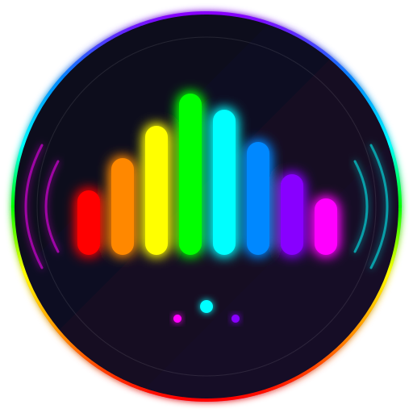

<div align="center">

# ColorfulSound

### Real-Time Audio Visualization for RGB LEDs

[](https://opensource.org/licenses/MIT)
[](https://www.java.com/)
[](https://www.arduino.cc/)
[]()
[](https://processing.org/)
[](https://github.com/sponsors/ayushmaanbhav)
[](http://makeapullrequest.com)

**Transform your music into a mesmerizing light show with real-time FFT audio analysis and Arduino-controlled RGB LEDs**

[Features](#-features) • [Demo](#-demo) • [Quick Start](#-quick-start) • [Architecture](#-architecture) • [API](#-api-reference) • [Contributing](#-contributing)

---



</div>

## Overview

ColorfulSound is a sophisticated audio visualization system that bridges digital sound with physical RGB lighting. Using Fast Fourier Transform (FFT) analysis and beat detection algorithms, it maps audio frequencies to a rainbow color spectrum in real-time, creating immersive lighting experiences synchronized to your music.

Whether you're building an ambient lighting setup, enhancing your music room, or creating a DJ booth visualization, ColorfulSound provides the software foundation to bring audio to life through color.

## Demo

<div align="center">

| Live Demo | Beat Detection |
|:---------:|:--------------:|
| [](https://youtu.be/1_jsy24fjsA) | [](https://youtu.be/-lKDS-QsK64) |
| *RGB LEDs in action* | *Frequency visualization* |

</div>

## Features

### Core Capabilities

| Feature | Description |
|---------|-------------|
| **Real-Time FFT Analysis** | 2048-sample buffer FFT processing using the Minim audio library |
| **Beat Detection** | Dual-mode detection: overall energy onset + frequency-range beats |
| **Dynamic Range Mapping** | Automatically adapts to the frequency content of your music |
| **Rainbow Color Blending** | Maps 7 rainbow colors (ROYGBIV) to frequency bands with smooth blending |
| **Cross-Platform** | Windows, Linux, macOS, and Raspberry Pi support |
| **System Tray Control** | Lightweight tray icon with full feature control |
| **Visual Debugging** | Optional Processing-based visualization window |

### Control Options

- **Enable/Disable** - Toggle LED output on/off
- **Color Change Mode** - Switch between dynamic colors and fixed color
- **Default Color Picker** - Choose your preferred static color with alpha
- **Sensitivity Modes** - High/Low sensitivity for different music types
- **Rainbow Shuffle** - Randomize the color-to-frequency mapping

## Architecture

### System Overview

```
┌─────────────────────────────────────────────────────────────────────────┐
│                         ColorfulSound System                            │
├─────────────────────────────────────────────────────────────────────────┤
│                                                                         │
│   ┌──────────────┐     ┌──────────────────────┐     ┌──────────────┐   │
│   │ Audio Input  │────▶│  Beat Detection &    │────▶│   Arduino    │   │
│   │   (Minim)    │     │   FFT Analysis       │     │  Connector   │   │
│   └──────────────┘     └──────────────────────┘     └──────────────┘   │
│          │                       │                          │          │
│          │                       ▼                          │          │
│          │             ┌──────────────────┐                 │          │
│          │             │  Color Mapping   │                 │          │
│          │             │  (Rainbow Blend) │                 │          │
│          │             └──────────────────┘                 │          │
│          │                       │                          │          │
│          ▼                       ▼                          ▼          │
│   ┌──────────────┐     ┌──────────────────┐     ┌──────────────────┐   │
│   │  System Tray │     │   Visualization  │     │    RGB LEDs      │   │
│   │     UI       │     │   (Processing)   │     │   (Hardware)     │   │
│   └──────────────┘     └──────────────────┘     └──────────────────┘   │
│                                                                         │
└─────────────────────────────────────────────────────────────────────────┘
```

### Component Design

```
com.ayush.colorfulsound
├── SoundEnergyBeatDetection.java    # Main application & audio processing
│   ├── BeatListener                  # AudioListener implementation
│   ├── setup()                       # Initialize audio, UI, Arduino
│   ├── draw()                        # Main loop: FFT + color calculation
│   ├── sendToArduino()               # Queue RGB values to serial port
│   └── blend()                       # Multi-color weighted averaging
│
├── SoundEnergyBeatDetectionGUI.java # Processing visualization mode
│   ├── PApplet extension             # Processing application base
│   └── Visual beat feedback          # Animated circles on beat
│
└── ArduinoConnector.java            # Serial communication handler
    ├── Platform detection            # Auto-detect serial ports
    ├── RXTX integration              # Cross-platform serial I/O
    └── Event handling                # Bidirectional communication
```

### Threading Model

```
┌─────────────────┐   ┌─────────────────┐   ┌─────────────────┐
│   Audio Thread  │   │  Queue Worker   │   │  Update Thread  │
│    (Minim)      │   │   (Executor)    │   │   (15ms loop)   │
├─────────────────┤   ├─────────────────┤   ├─────────────────┤
│ • Sample capture│   │ • Process queue │   │ • Decay radius  │
│ • Beat detection│   │ • Serial write  │   │ • Refresh LEDs  │
│ • Color calc    │   │ • Order guarantee│  │ • State sync    │
└─────────────────┘   └─────────────────┘   └─────────────────┘
         │                    ▲                      │
         └────────────────────┴──────────────────────┘
                    BlockingQueue<Runnable>
```

### Audio Processing Pipeline

```
Audio Input (Stereo, 2048 samples)
          │
          ▼
┌─────────────────────────────────┐
│      BeatDetect (Energy)        │  ──▶  Onset Detection (eRadius = 500)
│      Sensitivity: 100ms         │
└─────────────────────────────────┘
          │
          ▼
┌─────────────────────────────────┐
│    BeatDetect (Frequency)       │  ──▶  Per-band beat detection
│    Full spectrum analysis       │
└─────────────────────────────────┘
          │
          ▼
┌─────────────────────────────────┐
│     Dynamic Range Tracking      │  ──▶  Exponential smoothing (0.97)
│   Identify active frequencies   │
└─────────────────────────────────┘
          │
          ▼
┌─────────────────────────────────┐
│      Rainbow Color Mapping      │  ──▶  7 colors: R-O-Y-G-B-I-V
│   Blend matching frequencies    │       High freq → Violet
└─────────────────────────────────┘       Low freq  → Red
          │
          ▼
┌─────────────────────────────────┐
│       Amplitude Scaling         │  ──▶  RGB * (radius / 500)
│    Based on beat intensity      │
└─────────────────────────────────┘
          │
          ▼
      Serial Output (R, G, B)
```

## Quick Start

### Prerequisites

- **Java 8+** - [Download](https://adoptium.net/)
- **Arduino IDE** - [Download](https://www.arduino.cc/en/software)
- **RGB LED Strip or Module** - Common cathode or anode
- **Arduino Board** - Uno, Nano, or compatible

### Hardware Setup

#### Circuit Diagram

```
                    Arduino Uno
                   ┌───────────┐
                   │           │
    RGB LED        │    D11 ───┼──▶ Red (with resistor)
   (Common         │    D10 ───┼──▶ Green (with resistor)
   Cathode)        │    D9  ───┼──▶ Blue (with resistor)
                   │    GND ───┼──▶ Common Cathode
                   │           │
                   └───────────┘

    Note: Use 220Ω-330Ω current limiting resistors
```

#### For 12V LED Strips

> **Warning**: Arduino is a 5V device! For 12V LED strips, you must use transistors (TIP120/IRLZ44N) or a MOSFET driver. See [this guide](http://www.instructables.com/id/ARDUINO-CONTROLLED-12v-RGB-LED-STRIP/) for proper wiring.

### Installation

#### Step 1: Upload Arduino Firmware

```cpp
// Arduino/colorfulsound/colorfulsound.ino
// Pin configuration:
int redPin = 11;    // PWM pin for red
int greenPin = 10;  // PWM pin for green
int bluePin = 9;    // PWM pin for blue
```

1. Open `Arduino/colorfulsound/colorfulsound.ino` in Arduino IDE
2. For **common anode** LEDs, uncomment: `#define COMMON_ANODE`
3. Upload to your Arduino board

#### Step 2: Install RXTX Drivers (Windows Only)

Copy the appropriate DLL to your system:

| Architecture | Source | Destination |
|--------------|--------|-------------|
| 64-bit | `libraries/rxtx-2.2pre2-bins/win64/rxtxSerial.dll` | `C:\Windows\System32\` |
| 32-bit | `libraries/rxtx-2.2pre2-bins/win32/rxtxSerial.dll` | `C:\Windows\SysWOW64\` |

#### Step 3: Configure Audio Input

> **Important**: ColorfulSound listens to your system's audio output via "Stereo Mix" or "What U Hear"

**Windows:**
1. Right-click speaker icon → **Sounds** → **Recording** tab
2. Right-click → **Show Disabled Devices**
3. Enable **Stereo Mix** → Set as **Default Device**
4. Start ColorfulSound, then switch back to Microphone if desired

**Linux:**
```bash
# Use PulseAudio monitor
pactl load-module module-loopback
```

**macOS:**
- Use [Soundflower](https://github.com/mattingalls/Soundflower) or [BlackHole](https://existential.audio/blackhole/)

#### Step 4: Run the Application

**Option A: Pre-built Executable (Windows)**
```bash
exe/ColorfulSound.exe
```

**Option B: Java JAR (Cross-platform)**
```bash
java -jar exe/ColorfulSound.jar
```

**Option C: With Visualization (Development)**
```bash
# Run from IDE: SoundEnergyBeatDetectionGUI.main()
```

### Testing the Connection

1. **Test Serial Port:**
   ```bash
   # Run ArduinoConnector standalone
   java -cp "exe/ColorfulSound.jar" com.ayush.colorfulsound.ArduinoConnector

   # Type RGB values (0-255) to test LED response
   255    # Red full
   0      # Green off
   0      # Blue off
   ```

2. **Verify Detection:**
   - Check console output for detected COM port
   - LEDs should respond to typed values

## API Reference

### SoundEnergyBeatDetection

The main application class managing audio processing and LED control.

#### Configuration Fields

| Field | Type | Default | Description |
|-------|------|---------|-------------|
| `enabled` | `volatile boolean` | `true` | Master on/off for LED output |
| `colorEnabled` | `volatile boolean` | `true` | Dynamic colors vs fixed color |
| `defaultColor` | `volatile Color` | `RED` | Static color when dynamic disabled |
| `threshold1` | `volatile boolean` | `false` | High sensitivity mode |
| `threshold2` | `volatile boolean` | `false` | Low sensitivity mode |
| `eRadius` | `volatile float` | `500` | Beat intensity (decays to 50) |

#### Key Methods

```java
// Initialize audio, UI, and Arduino connection
public void setup()

// Main audio processing loop (called per sample buffer)
public void draw()

// Queue RGB values to Arduino (thread-safe)
private synchronized void sendToArduino(int r, int g, int b, float a)

// Blend multiple colors with weighted averaging
public static Color blend(List<Color> colors)
```

### ArduinoConnector

Cross-platform serial communication handler.

#### Supported Platforms

| Platform | Port Pattern |
|----------|--------------|
| macOS | `/dev/tty.usbserial-*` |
| Linux | `/dev/ttyUSB0`, `/dev/ttyACM0` |
| Windows | `COM3` (configurable) |
| Raspberry Pi | `/dev/ttyACM0` |

#### Serial Configuration

```java
BAUD_RATE = 9600
DATA_BITS = 8
STOP_BITS = 1
PARITY = NONE
TIMEOUT = 2000ms
```

### Arduino Protocol

The Arduino expects 3 consecutive bytes per frame:

| Byte | Range | Description |
|------|-------|-------------|
| 1 | 0-255 | Red intensity |
| 2 | 0-255 | Green intensity |
| 3 | 0-255 | Blue intensity |

```cpp
// Arduino receives RGB in sequence
void loop() {
    if (Serial.available() > 0) {
        // Reads R, G, B sequentially
        // Calls setColor(r, g, b) when complete
    }
}
```

## Technology Stack

<div align="center">

| Component | Technology | Purpose |
|:---------:|:----------:|:-------:|
|  | **Java 8** | Core application |
|  | **Arduino C** | Firmware |
|  | **Processing** | Visualization |

</div>

### Dependencies

| Library | Version | License | Purpose |
|---------|---------|---------|---------|
| [Minim](http://code.compartmental.net/tools/minim/) | Latest | LGPL | Audio input, FFT, beat detection |
| [Processing Core](https://processing.org/) | Latest | LGPL | Graphics framework |
| [RXTX](http://rxtx.qbang.org/) | 2.2pre2 | LGPL | Serial communication |
| [JOGL](https://jogamp.org/jogl/) | Latest | BSD | OpenGL for Processing |

## Project Structure

```
ColorfulSound/
├── Arduino/
│   └── colorfulsound/
│       └── colorfulsound.ino      # Arduino firmware
├── src/
│   └── com/ayush/colorfulsound/
│       ├── SoundEnergyBeatDetection.java      # Main app (449 lines)
│       ├── SoundEnergyBeatDetectionGUI.java   # Visual mode (133 lines)
│       └── ArduinoConnector.java              # Serial handler (134 lines)
├── libraries/
│   ├── minim/                     # Audio processing
│   ├── processing/                # Graphics + OpenGL natives
│   └── rxtx-2.2pre2-bins/         # Serial natives (Win/Linux/Mac)
├── exe/
│   ├── ColorfulSound.jar          # Compiled JAR
│   └── ColorfulSound.exe          # Windows executable
├── images/
│   ├── icon.png                   # Application icon (legacy)
│   └── icon.svg                   # Application icon (scalable)
├── launch4j/
│   └── config.xml                 # EXE wrapper config
└── docs/
    └── ...                        # Documentation
```

## Building from Source

### Eclipse IDE

1. Import as existing project (Eclipse metadata included)
2. Libraries are pre-configured in `.classpath`
3. Run `SoundEnergyBeatDetection.main()`

### Creating Executable JAR

```bash
# From Eclipse: Export → Runnable JAR File
# Main class: com.ayush.colorfulsound.SoundEnergyBeatDetection
# Library handling: Package required libraries into JAR
```

### Creating Windows EXE

1. Install [Launch4j](http://launch4j.sourceforge.net/)
2. Open `launch4j/config.xml`
3. Build → Creates `exe/ColorfulSound.exe`

## Troubleshooting

### Common Issues

| Issue | Solution |
|-------|----------|
| "Could not find COM port" | Check Arduino connection, verify drivers installed |
| No audio response | Enable Stereo Mix in Recording devices |
| LEDs always off | Check common anode/cathode setting in Arduino code |
| Colors inverted | Toggle `COMMON_ANODE` define in Arduino sketch |
| Port locked (Linux) | Run `sudo chmod 666 /dev/ttyUSB0` or add user to `dialout` group |

### Debug Mode

Run the GUI version for visual debugging:
```java
// Shows real-time beat visualization
SoundEnergyBeatDetectionGUI.main()
```

## Contributing

Contributions are welcome! Please see our [Contributing Guidelines](CONTRIBUTING.md) for details.

### Development Setup

1. Fork the repository
2. Clone your fork
3. Import into Eclipse or your preferred IDE
4. Make changes and test thoroughly
5. Submit a pull request

### Areas for Contribution

- [ ] Maven/Gradle build system
- [ ] Additional color mapping algorithms
- [ ] Web-based configuration interface
- [ ] Support for addressable LED strips (WS2812B)
- [ ] Audio file input mode
- [ ] Network streaming support

## Acknowledgments

- [Minim](http://code.compartmental.net/tools/minim/) - Powerful audio library
- [Processing Foundation](https://processing.org/) - Creative coding framework
- [RXTX Project](http://rxtx.qbang.org/) - Cross-platform serial communication
- Icon by [Alecive Flatwoken](https://www.iconarchive.com/artist/alecive.html)

## License

This project is licensed under the **MIT License** - see the [LICENSE](LICENSE) file for details.

```
MIT License

Copyright (c) 2016 Ayush Jain

Permission is hereby granted, free of charge, to any person obtaining a copy
of this software and associated documentation files (the "Software"), to deal
in the Software without restriction, including without limitation the rights
to use, copy, modify, merge, publish, distribute, sublicense, and/or sell
copies of the Software...
```

## Support the Project

If you find ColorfulSound useful, consider supporting its development:

<div align="center">

[](https://github.com/sponsors/ayushmaanbhav)

**UPI (India):** `8544130924@pthdfc`

</div>

---

<div align="center">

**Made with by [Ayush Jain](https://github.com/ayushmaanbhav)**

[](https://github.com/ayushmaanbhav/ColorfulSound)
[](https://github.com/ayushmaanbhav)

</div>
